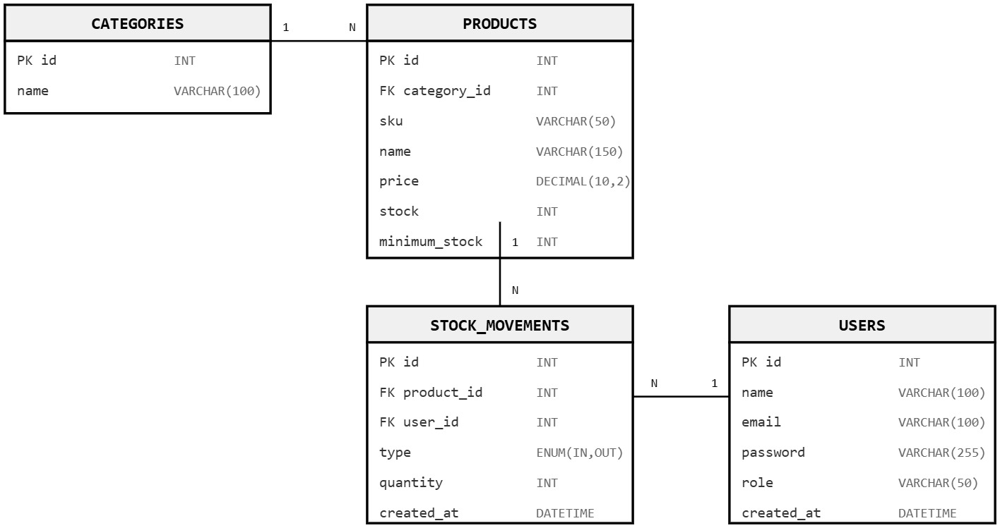
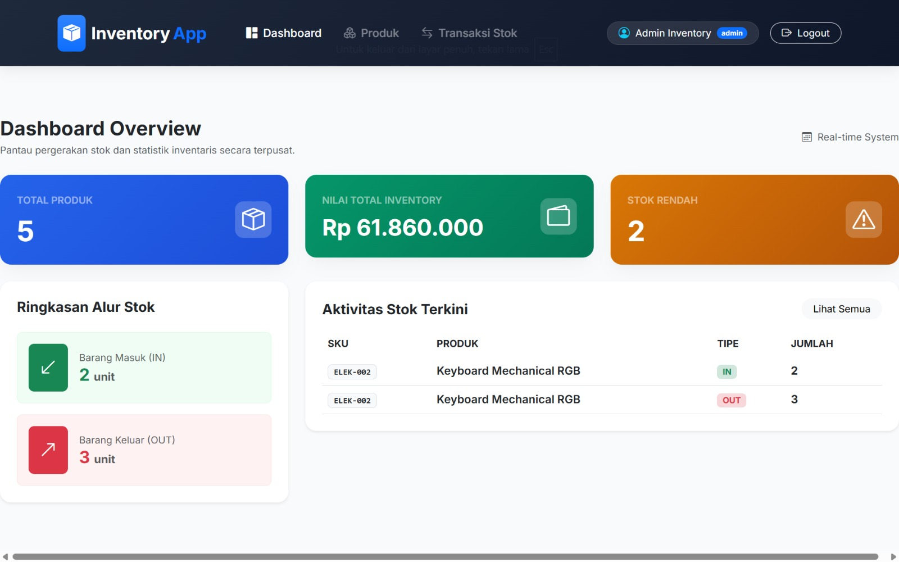
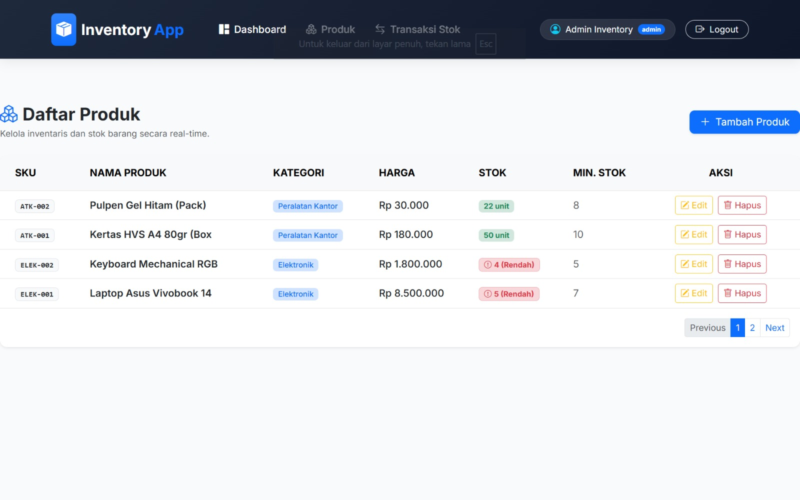
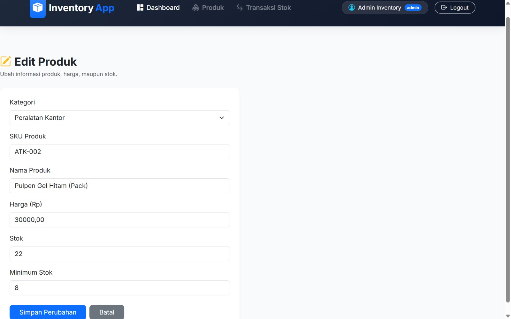
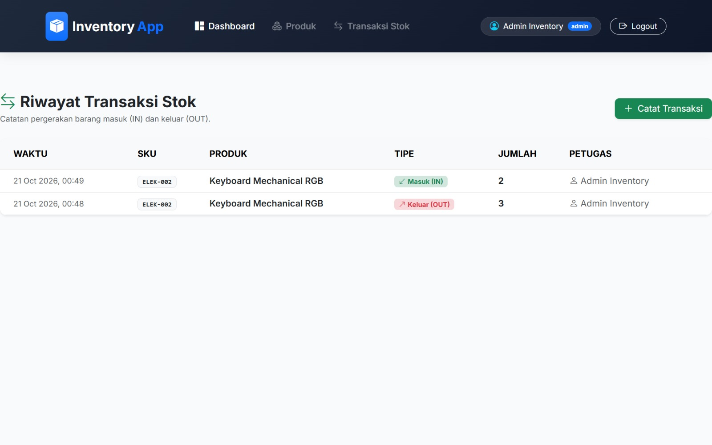

# Web Inventory Management System

Sistem Informasi Manajemen Inventaris dan Transaksi Stok berbasis web untuk mengelola data produk, memantau riwayat alur barang masuk dan keluar, serta menyajikan ringkasan status stok secara real-time. Aplikasi ini dikembangkan menggunakan PHP Native PDO dan antarmuka berbasis Bootstrap 5.

---

## Entity Relationship Diagram

Diagram berikut menggambarkan rancangan relasi antar-tabel dalam basis data inventory_app_db:

### Deskripsi Struktur Data
- **CATEGORIES**: Menyimpan data kategori produk untuk pengelompokan barang.
- **PRODUCTS**: Berisi informasi rinci produk, meliputi SKU, harga, jumlah stok, dan batas minimum stok.
- **USERS**: Mengelola data pengguna beserta hak akses yaitu Admin dan Staff.
- **STOCK_MOVEMENTS**: Mencatat setiap riwayat pergerakan stok barang masuk dan keluar yang terhubung dengan produk serta pengguna terkait.

---

## Antarmuka dan Penjelasan Fitur Utama

### 1. Dashboard Overview

**Penjelasan Fitur:**
- **Statistik Utama**: Menampilkan indikator total produk, nilai total aset inventaris, dan jumlah produk dengan status stok rendah secara real-time.
- **Ringkasan Alur Stok**: Visualisasi total akumulasi barang masuk dan barang keluar. Bagian ini dapat diklik untuk mengarahkan pengguna secara langsung ke halaman riwayat transaksi yang tersaring.
- **Tabel Aktivitas Terkini**: Menampilkan catatan 5 transaksi stok terakhir untuk pemantauan cepat tanpa harus membuka halaman riwayat secara penuh.

---

### 2. Manajemen Daftar Produk

**Penjelasan Fitur:**
- **Katalog Produk**: Menampilkan seluruh data produk dalam bentuk tabel yang rapi beserta indikator SKU, kategori, dan harga.
- **Badge Status Stok**: Penanda visual berwarna hijau untuk stok aman dan merah jika jumlah stok berada di bawah atau sama dengan batas minimum stok.
- **Sistem Pagination**: Pembagian halaman otomatis untuk menjaga performa muat data ketika jumlah produk berukuran besar.
- **Aksi Pengelolaan**: Menyediakan tombol Edit untuk memperbarui data produk dan tombol Hapus untuk menghapus item dari sistem.

---

### 3. Form Olah Data Produk

**Penjelasan Fitur:**
- **Input Data Interaktif**: Formulir terstandarisasi untuk menambah produk baru maupun memperbarui data produk yang sudah ada.
- **Validasi Relasional**: Pemilihan kategori yang terhubung langsung dengan tabel kategori basis data.
- **Batas Minimum Stok**: Pengisian nilai ambang batas minimum stok yang digunakan oleh sistem untuk memicu peringatan stok rendah di halaman dashboard.

---

### 4. Riwayat Transaksi dan Mutasi Stok

**Penjelasan Fitur:**
- **Pencatatan Mutasi**: Halaman khusus untuk mencatat pergerakan barang masuk dan barang keluar yang secara otomatis memutakhirkan jumlah stok produk terkait.
- **Log Transaksi Lengkap**: Menyajikan riwayat transaksi yang mencakup informasi waktu pencatatan, nama produk, jumlah mutasi, serta nama petugas yang melakukan pencatatan.
- **Fitur Penyaringan**: Memungkinkan pengguna menyaring daftar riwayat berdasarkan tipe transaksi tertentu yaitu barang masuk saja atau barang keluar saja.

---

## Tutorial Penggunaan Aplikasi

Berikut adalah panduan singkat cara menjelajahi dan menggunakan fitur aplikasi melalui navigasi web:

### 1. Mengakses Dashboard
- Setelah login, Anda akan otomatis diarahkan ke halaman Dashboard Overview.
- Pantau ringkasan total aset inventaris dan kartu peringatan Stok Rendah.
- Anda dapat mengklik kotak **Barang Masuk (IN)** atau **Barang Keluar (OUT)** untuk langsung melihat detail daftar riwayat transaksi terkait.

### 2. Mengelola Data Produk
- Pilih menu **Produk** pada navigasi atas untuk membuka daftar katalog barang.
- Klik tombol **Tambah Produk** di pojok kanan atas untuk menambah item baru. Isikan SKU, Nama, Kategori, Harga, Stok Awal, dan Batas Minimum Stok, lalu klik simpan.
- Untuk memperbarui data, klik tombol **Edit** pada baris produk yang diinginkan.
- Untuk menghapus data, klik tombol **Hapus** dan konfirmasi tindakan pada kotak dialog.
- Gunakan tombol nomor halaman pada bagian kanan bawah tabel (Pagination) untuk beralih antar-halaman data.

### 3. Mencatat Mutasi Stok (IN / OUT)
- Pilih menu **Transaksi Stok** pada navigasi atas.
- Klik tombol **Catat Transaksi**.
- Pilih Produk yang akan diperbarui stoknya, tentukan Tipe Transaksi (**Barang Masuk / IN** untuk menambah stok atau **Barang Keluar / OUT** untuk mengurangi stok), masukkan Jumlah Unit, lalu klik simpan.
- Sistem akan secara otomatis memutakhirkan jumlah stok di halaman produk dan mencatat log riwayatnya.

---

## Spesifikasi Teknologi

- **Bahasa Pemrograman**: PHP 8.x
- **Akses Basis Data**: PHP Data Objects (PDO)
- **Sistem Manajemen Basis Data**: MySQL / MariaDB
- **Kerangka Kerja UI**: Bootstrap 5.3 dan Bootstrap Icons
- **Prinsip Keamanan**: Implementation of PDO Prepared Statements, Session-based Authentication, and Foreign Key Integrity Constraints.

---

## Petunjuk Instalasi dan Penggunaan

### 1. Persyaratan Sistem
- Web Server lokal seperti Laragon (disarankan) atau XAMPP
- PHP versi 8.0 atau yang lebih baru
- MySQL Database Server

### 2. Langkah Instalasi (Menggunakan Laragon)
1. Buka Terminal Laragon atau Git Bash, lalu masuk ke direktori web server Laragon:
   bash
   cd C:\laragon\www
   git clone https://github.com/Arstaaw1/inventory_app.git inventory-app